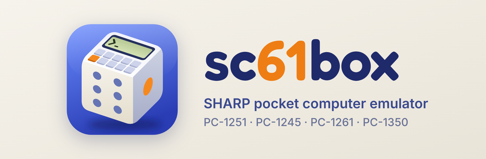
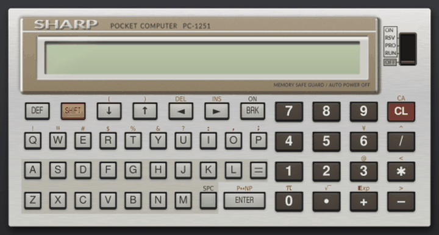
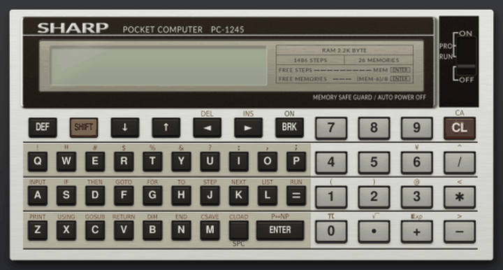

[日本語](README.md) | English

<p align="center"></p>

# sc61box: SHARP PC-1251/PC-1245/PC-1261/PC-1350 emulator

sc61box is an emulator of the SC61860, the CPU of the SHARP PC-1251, PC-1245, PC-1261 and PC-1350 pocket computers. The ROM is not included, but BASIC and machine-code programs run without it (see [Without a ROM](#without-a-rom)); the behaviour is made to match running with the ROM, but not everything is the same. With a ROM read out of a real machine, the emulator runs that ROM. Choose the model with `--model`; the default is the PC-1251.






The user guide, starting from installation on macOS and Windows, is [`doc/manual.pdf`](doc/manual.pdf) (in Japanese).

## Installing

You need [uv](https://docs.astral.sh/uv/). uv fetches a suitable Python by itself.

```sh
git clone https://github.com/woriguchi/sc61box.git
cd sc61box
uv run sc61box                 # start (works without a ROM)
```

## Without a ROM

Without a ROM, every model runs on a BASIC provided by the emulator (the ROM-less BASIC). The BASIC commands in the owner's manual work as they do with the ROM. Machine code can be typed in and run as well, with BASIC's `POKE` and `CALL` or in the machine-code workbench, which steps through it one instruction at a time and shows the registers and memory. Most of the bundled programs run too. `--norom` starts without the ROM even if you have it.

These are the main differences from running with the ROM. The user guide covers them in detail (the section 「ROMなしで使う」).

- The font is an original one and differs slightly from the real one.
- The last digits of results and the time things take may differ from the real machine.
- Machine code that calls a ROM routine works only if the emulator has a stand-in for that routine. A call to a routine with no stand-in stops there and returns to BASIC. Programs marked `# norom: off` are left out of the program list.
- Programs that read the contents of the ROM do not behave as they do with the ROM.

With `--no-basic`, the emulator shows only the machine-code workbench next to the machine, without BASIC. Writing your own stand-ins for ROM routines is described in `doc/norom.md`.

## Using the ROM

The ROM is Sharp's copyrighted work, so it is not included. To run the real BASIC, read the ROM out of a real machine and put it in `rom/` under these names. Only the files for the model you use are needed.

| File | Contents | Size |
| --- | --- | --- |
| `cpu-1251.rom` | PC-1251: the SC61860's internal ROM | 8192 bytes |
| `bas-1251.rom` | PC-1251: the BASIC ROM | 16384 bytes |
| `cpu-1245.rom` | PC-1245: the CPU's internal ROM | 8192 bytes |
| `bas-1245.rom` | PC-1245: the BASIC ROM | 16384 bytes |
| `cpu-1260.rom` | PC-1260/1261/1262: the CPU's internal ROM | 8192 bytes |
| `bas-1260.rom` | PC-1260/1261/1262: the BASIC ROM | 32768 bytes |
| `cpu-1350.rom` | PC-1350: the CPU's internal ROM | 8192 bytes |
| `bas-1350.rom` | PC-1350: the BASIC ROM | 32768 bytes |

For example, if you cloned into `~/src`, the files are `~/src/sc61box/rom/cpu-1251.rom` and `~/src/sc61box/rom/bas-1251.rom`.

yagshi's page "[Extracting ROM Data](https://www.oit.ac.jp/rd/labs/kobayashi-lab/~yagshi/old_web/misc/pocketcom/extrom.html)" (in Japanese) describes how to do it on a PC-1251, and "[SHARP PC-1245/50/51/55 の使い方](https://ht-deko.com/pc1245/)" (ht-deko.com, in Japanese) on a PC-1245. To keep the ROM elsewhere, set the environment variable `SC61BOX_ROM` to that folder. The window title ends with "(ROM BASIC)" when the ROM is used and "(ROM-less BASIC)" when it is not.

With the ROM or the ROM-less BASIC, Cmd+D (Ctrl+D) opens the workbench to step through machine code called from BASIC with `CALL`; its Run button types `CALL` for you while BASIC is waiting for input. The workbench is described in the user guide (the section 「マシン語の作業欄」).

## Updating from an earlier version

The GitHub history was rewritten in 0.7.0, so a folder cloned with `git clone` before 0.7.0 cannot be updated with `git pull` (it reports "divergent branches"). Run the commands below in that folder to move to the new version. The `rom/` folder and your data in `~/.sc61box` (saved RAM, programs and so on) stay as they are; files you changed inside the emulator folder are put back.

```sh
git fetch --force --tags
git reset --hard origin/main
```

After that, `git pull` updates it again.

A folder cloned under the old name (pc1251-emulator) is updated the same way, and the command is now `uv run sc61box`. The data folder `~/.pc1251` is moved to `~/.sc61box` on the first start. Environment variables are now named `SC61BOX_ROM` and so on; the old `PC1251_ROM` and the like are still read.

## Running

```sh
uv run sc61box --scale 0.8     # smaller window
uv run sc61box primes --run    # load the bundled primes.bas and run it
uv run sc61box ~/prog/game.bas  # load a file by path
uv run sc61box --fresh         # start without the saved RAM
uv run sc61box --norom         # run without the ROM, on the ROM-less BASIC
uv run sc61box --norom --no-basic  # run without the ROM, with only the machine-code workbench
uv run sc61box --state ~/.sc61box/state-1251.json  # start from a state saved with Shift+Cmd+S (state-1251-norom.json without a ROM)
uv run sc61box --lcd           # show only the LCD, without the calculator picture
uv run sc61box --model 1255    # start as a PC-1255 (1250 also works)
uv run sc61box --model 1245    # start as a PC-1245
uv run sc61box --model 1261    # start as a PC-1261 (1260 and 1262 also work)
uv run sc61box --model 1350    # start as a PC-1350 (--card 16 inserts a 16 KB RAM card)
uv run sc61box --model 1350 --overseas  # PC-1350 wired as the export model (lowercase letters instead of kana)
uv run sc61box --lang en       # English screen (--lang ja for Japanese)
uv run sc61box --help          # list the options
uv run sc61box --version       # print the version (please include it in bug reports)
```

On exit the RAM is saved to `~/.sc61box/ram.bin` (`ram-1245.bin` for the PC-1245, `ram-1261.bin` for the PC-1261, `ram-1350.bin` for the PC-1350) and restored at the next start. Without a ROM it goes to a separate file such as `ram-1251-norom.bin`.

## More

The [English guide](doc/guide.en.md) describes the rest:

- the display language
- loading BASIC text (`.bas`) and hex dumps (`.hex`) from the program list, and where to put programs
- the keys and the gamepad
- the bundled programs (Breakout, the PC-Interpreter), the printer and cassette audio (wav)
- running as a PC-1250, PC-1255, PC-1245, PC-1261 or PC-1350

## Assembler

`tools/asm61860.py` assembles SC61860 source (`.asm`) into a `.hex` file this emulator can load. Run it in the emulator folder:

```sh
uv run python tools/asm61860.py vline.asm vline.hex
uv run python tools/asm61860.py sprite.asm sprite.hex -D MASK=1   # give a value to a name used in IF
uv run python tools/asm61860.py add.asm add.hex --rom 1251        # use names of ROM routines (FADD, KEYSCAN, ...)
```

One instruction per line; `label:`, `; comment`, `ORG`, `EQU`, `DB` and `IF`/`ELSE`/`ENDIF` are available. Numbers are decimal; write hexadecimal as `&C000` or `0xC000`. `JR`, `JRZ`, `JRNZ`, `JRC` and `JRNC` pick the forward or backward form (`JRP`, `JRM` and so on) from the target. `lo()` and `hi()` take the low and high byte of a 16-bit value. The full syntax is described at the top of the file. Put the `.hex` together with a `.bas` of the same name in `~/.sc61box/programs/` to run it from the program list.

## Differences from the real machine

- Cassette input has been checked with recordings of real tapes (they load with `CLOAD`). The wavs the emulator writes have not been played into a real machine yet.
- The printer's paper feed key is not reproduced.
- The printer takes each byte at once, so programs do not wait for printing.
- Different ROM versions have not been checked.
- BASIC's `PEEK` can read the internal ROM here (according to the documentation, on the real machine only the `DATA` instruction can read it).

The memory map, I/O ports and LCD RAM layout are summarized in an appendix of the manual ([`doc/manual.pdf`](doc/manual.pdf), in Japanese).

## Development

This emulator was made with the help of Anthropic's Claude.

## Acknowledgements

This emulator was written with reference to the following emulators. Many thanks to their authors.

- [MAME](https://github.com/mamedev/mame)
- [PockEmul](https://github.com/paulie-g/PockEmul)
- [PokecomGO](https://github.com/digihori/pokecom)
- [Pokecom GO Plus](https://github.com/digihori/pokecom-go-plus)

## Rights

The emulator's code and artwork are released under the MIT License ([LICENSE](LICENSE)). Most of the sample programs in `programs/` were also written for this emulator and are covered by the same license. The exceptions: `lc3.hex` (the LC-3 compiler) and the article sources among the `lc3-` samples in `programs/pc1261/` (`lc3-hello`, `lc3-move`, `lc3-chars`) are works by LC-3's author COR (hiroog on GitHub) and are not covered by the MIT License. They are included under the author's statement in his [blog post of 3 January 2018](https://wlog.flatlib.jp/archive/1/2018-1-3) that LC-3 may be distributed freely and that dump lists, binaries and the like may be published as anyone likes.

`pcint.hex` (the PC-Interpreter) and `mogura.bas` (the mole-bashing game) in `programs/` are works by [Fan_PC-1251](https://x.com/pio1986_10), the author of the article in the August 1986 issue of PiO, and are not covered by the MIT License. They are included with the author's permission.

SHARP is a trademark of Sharp Corporation. This is an unofficial emulator made by an individual and has no connection with Sharp Corporation.
