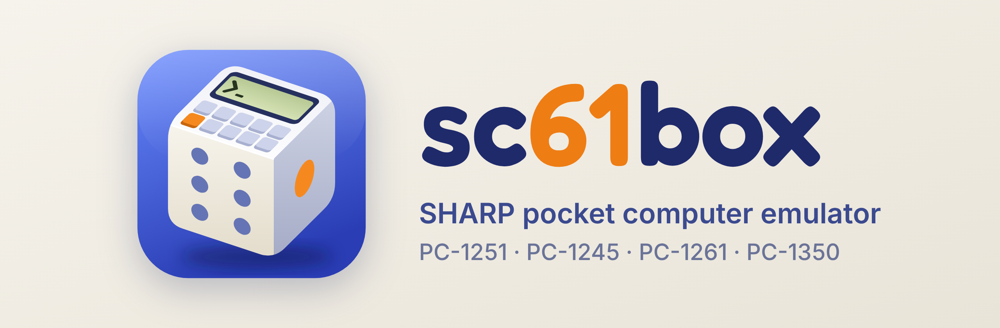
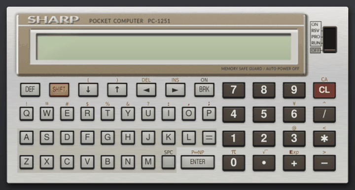
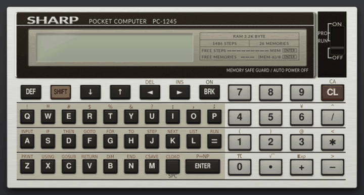

日本語 | [English](README.en.md)

<p align="center"></p>

# sc61box: SHARP PC-1251/PC-1245/PC-1261/PC-1350エミュレータ

sc61boxは、SHARPのポケコン(PC-1251・PC-1245・PC-1261・PC-1350)のCPU SC61860のエミュレータです。ROMは同梱していませんが、ROMがなくてもBASICとマシン語のプログラムを実行できます(ROM使用時とまったく同じ動作ではありません)。実機から読み出したROMを置けば、そのROMで動作します。

<p>




</p>

使い方は、手引き[`doc/manual.pdf`](doc/manual.pdf)でインストール方法から順に説明しています。

## ブラウザで動かす

インストールせずに、[https://sc61box.github.io/](https://sc61box.github.io/)をブラウザで開いても使えます。ブラウザ版はROMなしで動作します。録画、ゲームパッド、ROMを使った実行はできません。RAMの中身は機種ごとにブラウザに保存されます。一度開けば、ネットにつながっていなくても使え、ホーム画面に追加することもできます。

## インストールと起動

インストールには[uv](https://docs.astral.sh/uv/)を使います。Pythonはuvが用意します。

```sh
git clone https://github.com/woriguchi/sc61box.git
cd sc61box
uv run sc61box     # 起動(ROMがなくても動作します)
```

## ROMなしで動かす

ROMがない場合は、どの機種もエミュレータに内蔵したBASIC(ROMなしのBASIC)で動作します。取扱説明書に載っているBASICの命令は、ROM使用時と同じように使えます。マシン語は、BASICの`POKE`と`CALL`、またはマシン語の作業欄(1命令ずつ実行し、レジスタとメモリを確認できます)で入力して実行できます。見本のプログラムの多くもROMなしで動作します。ROMを置いている場合でも、`--norom`を付けるとROMなしで起動します。

ROM使用時とおもに違うのは、以下の点です。詳しくは、手引きの「ROMなしで使う」の節を参照してください。

- フォントは独自に作成したものです。実機のフォントとはやや異なります。
- 計算精度や、計算時間は実機と異なることがあります。
- マシン語のプログラムからROMのルーチンを呼んでいる場合は、エミュレータに代替ROMルーチンがある場合のみ動作します。代替ROMルーチンが存在しない場合には、警告を出して止まります。`# norom: off`を指定したプログラムは、一覧に表示されません。
- ROMの番地からデータを読み出すプログラムは、ROMなしでは正しく動作しません。ROMの番地には、フォントなどを除いてROMの内容が入っていないためです。

## ROMを置いて動かす

ROMはシャープの著作物のため同梱していません。実機と同じBASICで動かす場合は、実機から読み出したROMを、次の名前で`rom/`フォルダに置いてください。使う機種の分だけあれば動作します。

| 機種 | ファイル |
| --- | --- |
| PC-1251(PC-1250、PC-1255も) | `cpu-1251.rom`(8KB)、`bas-1251.rom`(16KB) |
| PC-1245 | `cpu-1245.rom`(8KB)、`bas-1245.rom`(16KB) |
| PC-1261(PC-1260、PC-1262も) | `cpu-1260.rom`(8KB)、`bas-1260.rom`(32KB) |
| PC-1350 | `cpu-1350.rom`(8KB)、`bas-1350.rom`(32KB) |

ROMの読み出し方は、手引きの「ROMを用意する」の節で説明しています。ROMで動作しているかどうかは、ウィンドウのタイトルの末尾が「(ROM BASIC)」か「(ROM-less BASIC)」かで確認できます。

## 前の版から新しくする場合

0.7.0でGitHubの履歴を書き直しました。そのため、0.6.1以前に`git clone`したフォルダは、`git pull`では更新できません(「divergent branches」と表示されます)。フォルダに移動して次のコマンドを実行すると、新しい版に更新できます。`rom/`フォルダと、ホームの`.sc61box`フォルダ(保存したRAMやプログラム)はそのまま残ります。エミュレータのフォルダ内で変更したファイルは元に戻ります。

```sh
git fetch --force --tags
git reset --hard origin/main
```

以降は、`git pull`で更新できます。

旧名(pc1251-emulator)で`git clone`したフォルダも、同じ方法で更新できます。起動コマンドは`uv run sc61box`です。データのフォルダ(`~/.pc1251`)は、初回の起動時に`~/.sc61box`へ移動します。環境変数は`SC61BOX_ROM`などの名前に変わりましたが、以前の`PC1251_ROM`なども読み込みます。

## 動かし方

```sh
uv run sc61box --model 1261    # 機種を選ぶ(1250、1251、1255、1245、1260、1261、1262、1350)
uv run sc61box primes --run    # 見本のプログラムを読み込んで実行する
uv run sc61box --norom         # ROMを使わずに起動する
uv run sc61box --norom --no-basic  # BASICなしで、マシン語の作業欄だけを使う
uv run sc61box --lang en       # 画面を英語にする
uv run sc61box --help          # オプションの一覧
```

エミュレータの操作は、本体の画像の下にある操作欄のボタンで行います。パソコンのキーと本体のキーの対応は、Cmd+/(WindowsとLinuxではCtrl+/)で表示される説明で確認できます。終了時にRAMを保存し、次回の起動時に復元します。

このほか、次の機能があります。使い方は手引きで説明しています。

- BASICのテキスト(`.bas`)や16進ダンプ(`.hex`)を、プログラムの一覧から読み込む。入力したプログラムをファイルに書き出す
- マシン語を1命令ずつ実行し、レジスタとメモリの変化を確認する(マシン語の作業欄)
- 状態を保存し、あとでその時点から再開する(どこでもセーブ)。画面と音を動画に録画する
- プリンタに印字する。カセットの音(wav)で、実機とプログラムを受け渡しする
- ゲームパッドで操作する。本体の画像を隠して液晶だけを拡大表示する。液晶の文字の間隔を詰めて表示する

## 見本のプログラム

`programs/`に、BASICとマシン語の見本(弾むボール、ブロック崩しなど)があります。PiO 1986年8月号の「PC-インタープリタ」([Fan_PC-1251](https://x.com/pio1986_10)氏作)と、そのもぐらたたきは、作者の了解を得て収録しています(どちらもROMなしで動作します)。[`doc/pcinterp.pdf`](doc/pcinterp.pdf)は、PC-インタープリタを1命令ずつ解説した小冊子『PC-インタープリタを読む』(おりぐち)です。PC-1261用には、COR氏のコンパイラLC-3(ポケコン・ジャーナル1989年6月号)とその見本を収録しています(ROMなしで動作します)。

## アセンブラ

`tools/asm61860.py`は、SC61860のソース(`.asm`)をアセンブルし、このエミュレータで読み込める`.hex`を出力するアセンブラです。書式の一覧はファイルの先頭にあります。

```sh
uv run python tools/asm61860.py vline.asm vline.hex
```

## 開発について

このエミュレータの開発にはAnthropicのClaudeを利用しています。

## 謝辞

このエミュレータは、次のエミュレータの実装を参考にしました。作者の方々に感謝します。

- [MAME](https://github.com/mamedev/mame)
- [PockEmul](https://github.com/paulie-g/PockEmul)
- [PokecomGO](https://github.com/digihori/pokecom)
- [Pokecom GO Plus](https://github.com/digihori/pokecom-go-plus)

## 権利について

このエミュレータのコードと画像は、MITライセンスで公開しています([LICENSE](LICENSE))。`programs/`の見本のプログラムも、大部分はこのエミュレータのために作成したもので、同じくMITライセンスです。ただし、`programs/pc1261/`の`lc3.hex`(コンパイラLC-3)と、`lc3-`で始まる見本のうち記事のソース(`lc3-hello`、`lc3-move`、`lc3-chars`)は、LC-3の作者COR氏(GitHubではhiroog氏)の著作物で、MITライセンスには含まれません。作者が2018年1月3日の[ブログ記事](https://wlog.flatlib.jp/archive/1/2018-1-3)で「LC-3 の配布に関しては自由に行っていただいて構いません。ダンプリスト、バイナリ等、任意に掲載していただいて結構です。」と述べているのに従って同梱しています。コンパイラは[hiroog/LC3_Compiler](https://github.com/hiroog/LC3_Compiler)の`LC-3.bin`を元にしています。

`programs/`の`pcint.hex`(PC-インタープリタ)と`mogura.bas`(もぐらたたき)は、PiO 1986年8月号の記事の作者[Fan_PC-1251](https://x.com/pio1986_10)氏の著作物で、MITライセンスには含まれません。作者の了解を得て同梱しています。

SHARPはシャープ株式会社の商標です。このエミュレータは個人が開発した非公式のもので、シャープ株式会社とは関係ありません。
